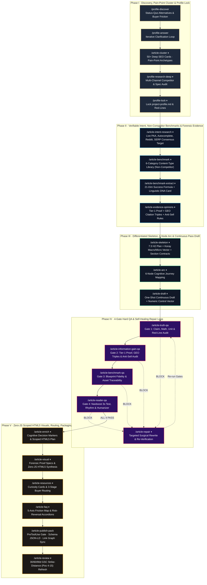

# B2B SEO & GEO Agent Engine (`v3.4`)

[](#)
[](#5-repository-topology--skill-graph)
[](#5-repository-topology--skill-graph)
[](#4-deterministic-harness-guardrails-vs-model-judgment)
[-15803d?style=flat-square)](#7-verification--test-suite)
[](./LICENSE)

> **An Agent-Native, Evidence-Bounded B2B Technical Content & Generative Engine Optimization (GEO) Operating System.**  
> Built for high-ticket industrial manufacturing, custom engineering, and commercial specification markets where generic "SERP-average" AI articles collapse during Google Core Updates.
>
> **一套专为高客单价 B2B 工业制造与工程选型打造的 Agent-Native 深度内容与 GEO（生成式引擎优化）操作系统。**  
> 拒绝「抓前十名拼凑均值」的 AI 洗稿套路：以 **22 阶人机对等共研状态机 + 9 大国际顶尖 SEO/GEO 流派方法论 + 4 道硬性 QA 门禁 + `PreToolUse` 底层物理拦截钩子 + 零脚本（Zero-JS CSP）内联交互式视觉组件**，生产只有真工厂与一线总工才写得出的高转化内容。

---

## 1. Why 99% of "AI SEO Workflows" Fail in High-Ticket B2B

Most open-source SEO agents follow the same fatal loop: *scrape the top 5 Google results → average their H2 headings → prompt an LLM to write 2,500 words → inject keywords*.

In high-ticket B2B procurement (architectural metalwork, commercial ESS/inverters, CNC fabrication, industrial automation), that loop fails on four fronts:

1. **The Commodity Consensus Trap (`US20200349181A1` Information Gain Penalty)**: Repeating what the current SERP Top 5 already say yields zero Information Gain. Post-March 2026 Core Update studies show factually "correct" but non-unique B2B domains losing 95%+ of organic traffic.
2. **B2C Traffic Pollution**: High-volume head terms (`room divider ideas`, `cheap solar panel`) attract DIY homeowners instead of commercial specifiers (architects, EPC engineers, hospitality procurement directors).
3. **Wall-of-Text Pogo-Sticking (Navboost Decay)**: Commercial buyers scanning a 3,500-word spec guide bounce within 3 seconds if the opening viewport is a giant stock hero image followed by throat-clearing definitions.
4. **LLM Spec Hallucination & Mechanical Slop**: Unbounded agents invent tolerances, mix up `kW` vs. `kWh`, repeat the same case study across 30 articles, or evaluate prose using brittle regex word-counters instead of genuine editorial judgment.

**B2B SEO & GEO Agent Engine (`v3.4`)** solves this by separating **Deterministic Harness Guardrails** (state-machine verification, artifact completeness, CSP security, fact-rotation ledgers) from **Pure Model Judgment** (benchmark transmutation, forensic shop-floor specificity, contrarian counter-narratives, and 4-gate editorial QA).

---

## 2. The 22-Stage Peer Co-Research Architecture (`⏸`)

Every workflow stage writes durable, schema-validated artifacts into `content-workspace/<project-slug>/` and pauses (`=== ⏸ 停止 · 对等共研与校准 ===`) for **Human-AI Peer Co-Research** — where neither human intuition nor AI assumption wins by default; only verified evidence, physical engineering logic, and buyer search intent win.



---

## 3. Nine World-Class SEO, GEO & B2B Frameworks Baked Into the Skill Graph

Rather than prompting the model with generic "write high-quality E-E-A-T content" instructions, the 42 skills encode concrete, falsifiable mechanisms synthesized from nine industry-leading practitioners and research groups:

| Framework / Pioneer | Core Mechanism Encoded in `v3.4` | Target Skills & Templates |
|---|---|---|
| **1. Grow and Convert**<br>*(Benji Hyam & Devesh Khanal — Pain-Point SEO)* | **5 High-Converting B2B Archetypes** (Category/Spec Commercial, X-vs-Y Honest Comparison, Technical Bottleneck/Failure JTBD, Cost Anatomy & Quote Red-Flag, Compliance/Tolerance Disqualification) + **B2C/DIY SERP Noise Filter** + **Zero-Volume High-Ticket Override** (`≥7.0/10` volume floor for $5k–$100k+ RFQ queries). | [`article-cluster`](.claude/skills/article-cluster/SKILL.md)<br>[`topic-cluster-researcher`](.claude/agents/topic-cluster-researcher.md)<br>[`deep-seo-card.md`](templates/deep-seo-card.md) |
| **2. Holistic SEO**<br>*(Koray Tuğberk GÜBÜR — Contextual Vector & Cost of Retrieval)* | **Macro-Context Core vs. Micro-Context Bridge** (first 75% of H2s strictly locked on primary entity + commercial decision vector; supplementary install/maintenance bridges restricted to final 25%) + **BLUF Zero Throat-Clearing Rule** + **Extractive Format Lock** (`paragraph` \| `comparison-table` \| `ordered-steps` \| `checklist`). | [`article-skeleton`](.claude/skills/article-skeleton/SKILL.md)<br>[`h2-heading-strategy.md`](templates/h2-heading-strategy.md)<br>[`section-contracts.md`](templates/section-contracts.md) |
| **3. Princeton / Georgia Tech KDD 2024**<br>*(GEO: Generative Engine Optimization)* | **GEO Citation Triples**: Every decision-critical H2 combines **(1) Condition-bounded statistics (`+37%` visibility)**, **(2) Attributable Named-Engineer or Primary-Standard quotes (`+40%` visibility)**, and **(3) Physical cause-and-effect failure chains (`+30%` visibility)** inside a 40–60 word self-contained RAG passage. | [`article-evidence-opinions`](.claude/skills/article-evidence-opinions/SKILL.md)<br>[`evidence-opinion-pack.md`](templates/evidence-opinion-pack.md)<br>[`article-information-gain-qa`](.claude/skills/article-information-gain-qa/SKILL.md) |
| **4. Animalz**<br>*(Ryan Law — Counter-Narrative & Thesis-Driven B2B)* | **3-Step Counter-Narrative Matrix**: `SERP Conventional Wisdom (Antithesis) → Forensic Shop-Floor Teardown (Cause-and-Effect Chain) → Conditional Engineering Rule (Synthesis: If [Condition A] → [Spec X]; if [Condition B] → [Spec Y])`. | [`article-evidence-opinions`](.claude/skills/article-evidence-opinions/SKILL.md)<br>[`evidence-opinion-pack.md`](templates/evidence-opinion-pack.md) |
| **5. April Dunford**<br>*(Obviously Awesome — Status-Quo Competitive Alternatives)* | **Cross-Material Inertial Enemy Mapping**: Audits what buyers default to when they don't buy your category at all (e.g., frameless glass, drywall, timber slats, local sign-shop painted mild steel) and documents the 12–24 month failure mode and hidden rework TCO. | [`profile-discover`](.claude/skills/profile-discover/SKILL.md)<br>[`project-profile.md`](templates/project-profile.md) |
| **6. Wynter / CXL & Alex Hormozi**<br>*(Peep Laja — B2B Buyer Friction & Risk-Reversal)* | **5-Axis B2B Procurement Friction Taxonomy**: Maps every FAQ and routing module to Implementation/Site-Fit, QC/Crating-Damage, Financial/TCO/CFO-Approval, MOQ/Sample/Lead-Time, or Compatibility/Spec-Boundary friction. | [`article-faq`](.claude/skills/article-faq/SKILL.md)<br>[`article-resources`](.claude/skills/article-resources/SKILL.md) |
| **7. Zyppy SEO**<br>*(Cyrus Shepard — Internal Linking Laws)* | **First-Link Priority Law** (ensuring the DOM-first link to any target URL carries a rich 4–7 word entity-attribute anchor) + **Cross-Article Anchor Variation** + automated `site-link-graph.json` **Inbound Retro-Link Checklist** to eliminate orphan pages. | [`internal-linking`](.claude/skills/internal-linking/SKILL.md)<br>[`update_link_graph.py`](scripts/update_link_graph.py) |
| **8. Clearscope**<br>*(Bernard Huang — Strike-Distance Refresh Protocol)* | **Position 4–15 Strike-Distance Query Injection**: At 30/60/90-day reviews, extracts high-impression GSC queries ranking at positions 4–15 and injects surgical H3 or `<details class="b2b-mod-faq">` blocks with GEO Citation Triples. | [`article-review`](.claude/skills/article-review/SKILL.md)<br>[`performance-review-strategist`](.claude/agents/performance-review-strategist.md) |
| **9. Authority Hacker**<br>*(Gael Breton & Mark Webster — Linkable Stat-Blocks)* | **Passive Backlink Magnets**: Requires at least one `#id`-anchored reference dataset (tolerance matrix, 5-year TCO breakdown, or failure-threshold lookup table) per flagship guide for trade journalists and specifiers to cite. | [`evidence-policy`](.claude/skills/evidence-policy/SKILL.md)<br>[`article-html-visuals`](.claude/skills/article-html-visuals/SKILL.md) |

---

## 4. Deterministic Harness Guardrails vs. Model Judgment

A core design principle of `v3.4` is **strict separation of concerns between code and LLM**:

- **100% Model Judgment for Editorial Quality**: We never use regex word-counters, mechanical syllable formulas, or rigid keyword-density scripts to score prose or titles. Voice, rhythm, argument sharpness, and title CTR hooks are evaluated by the LLM against real non-competitor exemplars (`Linguistic DNA Card` + `Numeric Control Vector`).
- **100% Deterministic Code for Workflow & Security Boundaries**:
  1. **`PreToolUse` Harness Boundary Hook ([`scripts/hooks/publish_gate.py`](scripts/hooks/publish_gate.py))**: Registered in [`.claude/settings.json`](.claude/settings.json). Physically intercepts `Write`/`Edit` calls to `publish-package.md` or `publish-ready-body.md` unless all 4 QA gates (`truth-qa.md`, `information-gain-qa.md`, `benchmark-drift-audit.md`, `reader-qa.md`) explicitly record `PASS`, all post-enrich modules (`visual-spec.md`, `resources.md`, `faq.md`) are merged, and zero inline JavaScript (`<script>`, `on*=`) or forbidden glossary terms exist.
  2. **Zero-JS CSP-Safe Scoped HTML5 Visual Engine ([`article-html-visuals`](.claude/skills/article-html-visuals/SKILL.md))**: Instead of monotonous walls of text or fragile external JS widgets, articles weave native, self-contained HTML5/CSS3 interactive modules that survive strict Content Security Policies (`script-src 'self'`, `style-src 'self' 'unsafe-inline'`):
     - **Pure CSS Radio-Tab Scenario Switchers** (`<input type="radio">` + `:checked` sibling selectors)
     - **Above-the-Fold 3-Path Buyer Router Strips** (anti-pogo-sticking Navboost anchor)
     - **Forensic Quote Red-Flag Annotators** (teaching buyers how to spot supplier spec-cheating on competing quotes)
     - **30-Second Internal Champion CFO / Procurement TCO Ledgers** (Gartner Buying Committee enablement)
     - **Safe-Zone vs. Failure-Zone Engineering Gauge Bars & `user-select: all` Copyable RFQ Blocks**
  3. **Anti-Footprint Fact Rotation ([`scripts/sync_draft_born_claims.py`](scripts/sync_draft_born_claims.py))**: Tracks `used_in_articles` and `usage_count` across `knowledge/fact-library.json` so a 50-article cluster automatically rotates Tier-1 factory/project proofs instead of repeating the same case study on every page.
  4. **Bidirectional Internal Link Graph ([`scripts/update_link_graph.py`](scripts/update_link_graph.py))**: Maintains `knowledge/site-link-graph.json` and auto-generates the **Inbound Retro-Link Checklist (`《旧文回链清单》`)** at publish time so older articles link forward to every newly published piece.

---

## 5. Repository Topology & Skill Graph

```text
.
├── CLAUDE.md / AGENTS.md                # Dual-Constitution for Claude Code, Codex, Gemini & Kimi
├── config/
│   ├── workflow-spec.yaml               # Single source of truth: 22 stages, gates & constants
│   ├── artifact-graph.yaml              # Input/output artifact dependencies per stage
│   ├── state-schema.json                # JSON Schema for workspace state.json
│   └── profile-schema.json              # JSON Schema for locked project-profile.json
├── .claude/
│   ├── settings.json                    # PreToolUse hook registration (publish_gate.py)
│   ├── agents/                          # 5 specialized subagents
│   │   ├── topic-cluster-researcher.md
│   │   ├── content-repair-strategist.md
│   │   ├── publish-package-qa.md
│   │   ├── publish-readiness-agent.md
│   │   └── performance-review-strategist.md
│   └── skills/                          # 43 modular skills + 12 deep reference playbooks
│       ├── system-setup/                # New-machine doctor & persistent Apify token hot-swap
│       ├── profile-discover/            # Discovery & April Dunford Status-Quo Alternatives
│       ├── article-cluster/             # 50+ Pain-Point SEO Cards & Cannibalization Guard
│       ├── article-intent-research/     # Live PAA, Autocomplete, Reddit & SERP Consensus Target
│       ├── article-benchmark-extract/   # 21-Dim Success Formula & Linguistic DNA Card
│       ├── article-evidence-opinions/   # Tier-1 Proof, GEO Citation Triples & Animalz Matrix
│       ├── article-skeleton/            # 7:3 H2 Plan, Koray Macro/Micro Vector & Contracts
│       ├── article-draft/               # One-shot continuous pass + Numeric Control Vector
│       ├── article-html-visuals/        # Zero-JS CSP Scoped HTML5 interactive components
│       ├── voice-and-humanization/      # 24 AI-writing anti-patterns + B2B forensic syntax
│       └── ... (43 skills total)
├── templates/                           # 24 standardized Markdown/JSON artifact templates
├── scripts/                             # Deterministic validators, assemblers & hooks
│   ├── setup_env.py                     # Zero-dependency environment doctor & bootstrapper
│   ├── apify_research.py                # Apify Actor runner + persistent token-pool manager
│   ├── hooks/publish_gate.py            # PreToolUse physical publish gate
│   ├── validate_publish.py              # End-to-end pre-publish artifact & CSP validator
│   ├── assemble_publish_draft.py        # Merges enriched draft + HTML5 visuals + {{CITE}} index
│   ├── render_html_visual.py            # Renders full-article preview inside host theme shell
│   ├── sync_draft_born_claims.py        # Updates & rotates knowledge/fact-library.json
│   ├── update_link_graph.py             # Updates site-link-graph.json & retro-link checklist
│   ├── denoise_html.py                  # Strips nav/footer noise before Linguistic DNA extraction
│   └── deep_audit.py                    # Structural & TRACE compliance auditor
├── content-workspace/                   # End-to-end showcase workspaces
│   ├── example-metal-divider/           # Architectural stainless steel screens showcase
│   └── sunriver-inverter/               # Commercial hybrid solar inverter showcase
└── tests/                               # 43 unittest + 63 pytest deterministic test cases
```

---

## 6. Quickstart & Cross-Machine Setup

### 1. First-Time Setup on Any Computer (`/system-setup`)
After cloning onto a new machine, either paste your Apify API key(s) directly in chat (`/system-setup apify_api_...`) or run the zero-dependency bootstrapper:
```bash
# Auto-install missing Python deps (PyYAML), verify hooks, and save persistent Apify token(s) (chmod 600):
python3 scripts/setup_env.py --fix --set-apify-tokens apify_api_YOUR_KEY_1 apify_api_YOUR_KEY_2
```
- Tokens are persisted with `0600` permissions to **both** `~/.config/b2b-seo-agent/apify.env` (machine-wide across all future sessions and projects) and `.env.apify.local` (repo-local, git-ignored).
- **Mid-Workflow Token Hot-Swap**: Whenever a token expires or exhausts its monthly quota mid-task, simply paste a new `apify_api_...` key in chat (or run `python3 scripts/apify_research.py add-token <new_key> --prepend --prune-dead`) — the agent hot-swaps the primary slot, prunes dead keys, and resumes the current stage without losing progress.

### 2. Start a New B2B Project Workspace
Invoke `/profile-discover` inside Claude Code with a brief description of your business:
```text
/profile-discover "We manufacture custom architectural 304/316 stainless steel screens for hotels and commercial interiors."
```

### 3. Inspect Pipeline Status or Advance Safely at Any Time
```text
/workflow-status content-workspace/example-metal-divider metal-room-divider-design-guide
```

### 4. Assemble & Preview a Completed Article in the Host Theme Shell
```bash
# Assemble publish-ready-body.md and index {{CITE: ...}} external tool slots
python3 scripts/assemble_publish_draft.py content-workspace/example-metal-divider metal-room-divider-design-guide

# Render a live host-theme HTML preview (Zero-JS CSP verified)
python3 scripts/render_html_visual.py --preview-article content-workspace/example-metal-divider metal-room-divider-design-guide
```

---

## 7. Verification & Test Suite

Run the full verification suite before committing any skill, template, or script changes:

```bash
# 1. Validate workflow-spec.yaml, artifact-graph.yaml, state-schema.json, and all 42 SKILL.md frontmatters
python3 scripts/validate_discovery_profile_workflow.py

# 2. Run the deep structural & TRACE audit (must report: Total issues found: 0)
python3 scripts/deep_audit.py

# 3. Run the full unittest & pytest suites (41 unittest + 61 pytest)
python3 -m unittest discover -s tests -v
python3 -m pytest tests/ -q
```

---

## License

Released under the [MIT License](./LICENSE).
